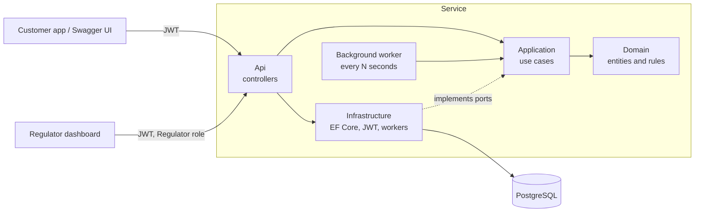
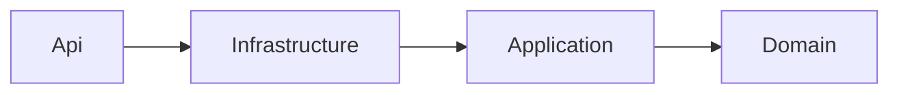
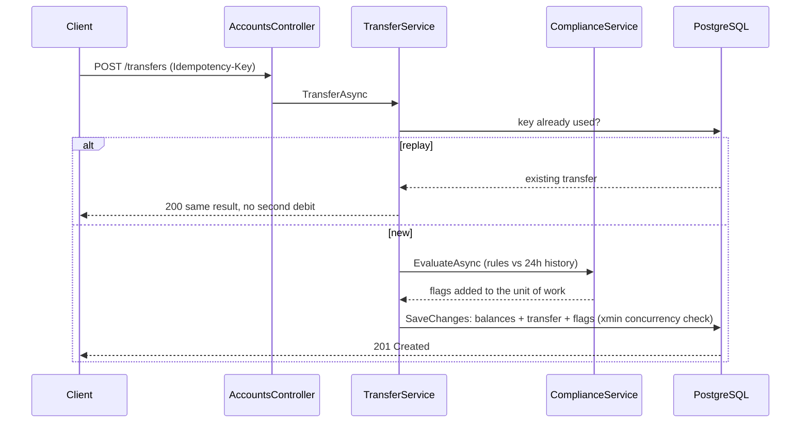
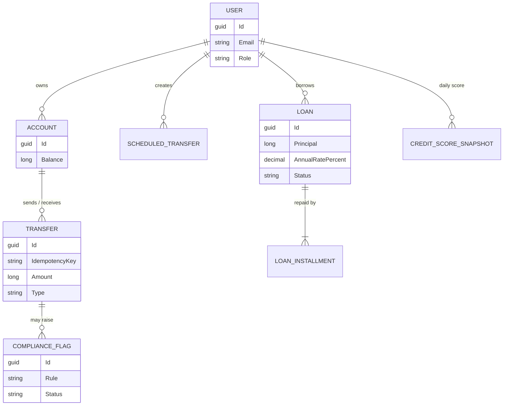
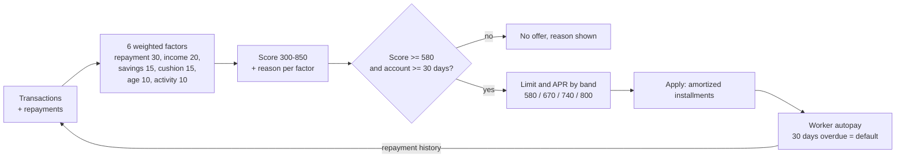
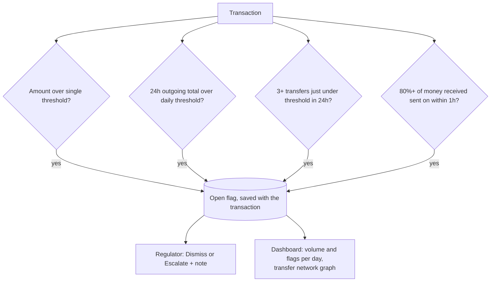

# WalletApi

ASP.NET Core 9 Web API for a digital wallet: JWT auth, accounts, deposits, idempotent transfers, scheduled payments, a transparent credit score, lending, and regulator compliance monitoring with a dashboard.

## Architecture
Clean Architecture, inward-only dependencies (see [ADR 1](docs/adr/0001-clean-architecture.md)):

    src/WalletApi.Domain          entities, rules
    src/WalletApi.Application     use cases + ports
    src/WalletApi.Infrastructure  EF Core/Postgres, JWT, background worker
    src/WalletApi.Api             controllers, composition root
    tests/WalletApi.Application.Tests

Repo standards: central package management, `global.json`, `.editorconfig` + warnings-as-errors, ADRs, CODEOWNERS, PR template, Dependabot, CI (format, build, test, Postgres smoke test, Docker build).

## Diagrams

### System overview

### Layer dependencies (inward only)

### Transfer: idempotent, atomic, flagged in the same commit

### Data model

### Credit score to loan offer

### Compliance monitoring

## Run
    Swagger UI: http://localhost:8080/swagger       Dashboard: http://localhost:8080/dashboard.html
    Seeded regulator (compose only): regulator@wallet.local / Regulator#12345
    docker compose up --build        # API on :8080, worker ticks every 2s in compose
    dotnet test

## Endpoints
| Method | Path | Notes |
|---|---|---|
| POST | /api/auth/register, /api/auth/login | returns `{token}` |
| GET | /api/accounts | your accounts |
| POST | /api/accounts/{id}/deposit | `{amount}` |
| POST | /api/accounts/transfers | header `Idempotency-Key`; `{fromAccountId,toAccountId,amount}` |
| POST | /api/scheduled-transfers | `{fromAccountId,toAccountId,amount,interval: Daily/Weekly/Monthly,firstRunAt}` |
| GET / DELETE | /api/scheduled-transfers[/{id}] | list / cancel |
| GET | /api/credit/score, /api/credit/history | 300-850 score with per-factor reasons; daily trend |
| GET / POST | /api/loans/offer, /api/loans | offer from score; apply (30-day-old account, one active loan) |
| POST | /api/loans/{id}/repay | pay next installment now (autopay also collects due ones) |
| GET | /api/compliance/flags, /stats, /network | **Regulator role only**; flags, per-day chart data, transfer graph |
| POST | /api/compliance/flags/{id}/review | Regulator: Dismissed or Escalated + note |

## Compliance rules (thresholds in `Compliance` config, minor units)
Large transaction, 24h outgoing total, structuring (repeated transfers just under the threshold), rapid pass-through (money in then out within 1h). Flags commit atomically with the transaction; loan movements are exempt.

## Credit score
Weighted scorecard 300-850: repayment history 30%, income regularity 20%, savings rate 15%, balance cushion 15%, account age 10%, activity 10%. Thin files get neutral values; every factor returns a plain-language reason ([ADR 4](docs/adr/0004-credit-scorecard.md)).

## Roadmap checklist
- [x] Auth (JWT), accounts, deposits
- [x] Idempotent atomic transfers with optimistic concurrency
- [x] Scheduled payments (daily/weekly/monthly) with background worker
- [x] CI: format, build, test, Postgres smoke test, Docker build
- [x] Swagger/OpenAPI docs with JWT auth
- [x] Credit score (weighted scorecard) with history chart
- [x] Lending: offer, apply, amortized schedule, autopay, default after 30 days overdue
- [x] Regulator role: configurable flag rules, review workflow, stats and network graph, dashboard
- [ ] **Account verification via Fayda (Ethiopia's national digital ID)** - next step: verification status on `User`, a `IIdentityVerifier` port in Application, a Fayda adapter in Infrastructure, and gating transfers above a limit on verified accounts. Requires Fayda/NIDP integration access.
- [ ] EF Core migrations (replace `EnsureCreated`)
- [ ] Refresh tokens, rate limiting, audit log
- [ ] Multi-instance-safe scheduler (`FOR UPDATE SKIP LOCKED`, see ADR 3)
- [ ] Integration tests with Testcontainers; OpenTelemetry metrics
